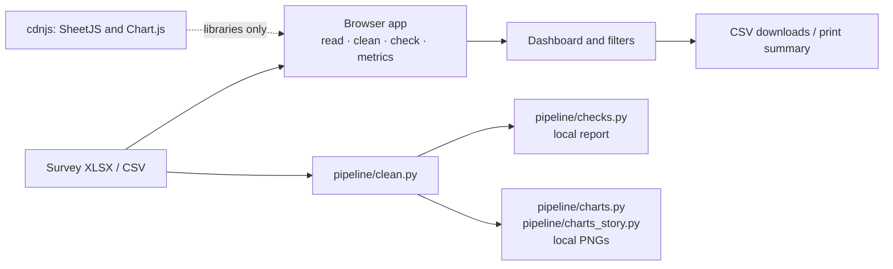

# 988 Training Insights Architecture

The app processes survey exports locally in a browser. A Python pipeline provides reference checks and charts.

## Components

- `web/index.html` contains the browser data core and UI. It reads files with SheetJS, matches columns by keywords, cleans and checks all rows, computes metrics, and renders charts with Chart.js. The top-level group filter is shared by all visualizations: everyone (students + adults), students only, adults only, or a students/adults comparison. The data visualizations include approximate mention counts for keyword-coded improvement-comment themes; comment text is not shown.
- `pipeline/clean.py` provides `load_and_clean(path)`. `checks.py` generates possible-issue reports; both chart scripts clean the input and write PNGs. There is no Python orchestration or metrics module currently.

## Data Rules

Survey contents never leave the browser or local machine. The browser CSP blocks network connections; only pinned library scripts load remotely. Browser logic mirrors Python definitions, with a reference-data parity self-test (`window.runSelfTest()`). Keep both implementations aligned when changing rules.

Agree means 4 or 5; only respondents selecting Student alone are students, and all other roles are adults; a session is training date plus county. The group filter applies to every chart. Groups under 10 are not compared. Improvement suggestions are grouped into specific themes using approximate English and Spanish keyword matches; no-suggestion and praise-only comments are excluded from those themes. Themes with no matches are hidden, and the remaining themes are sorted by mention count. A comment can match multiple themes, so mention counts can overlap. “Before” ratings are retrospective and may overstate knowledge gains. Warnings are possible issues, not confirmed errors, and responses are retained.