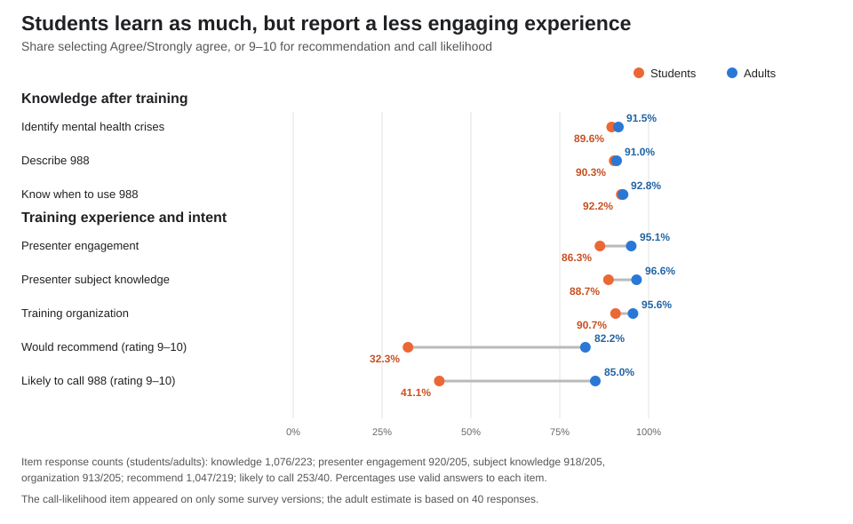
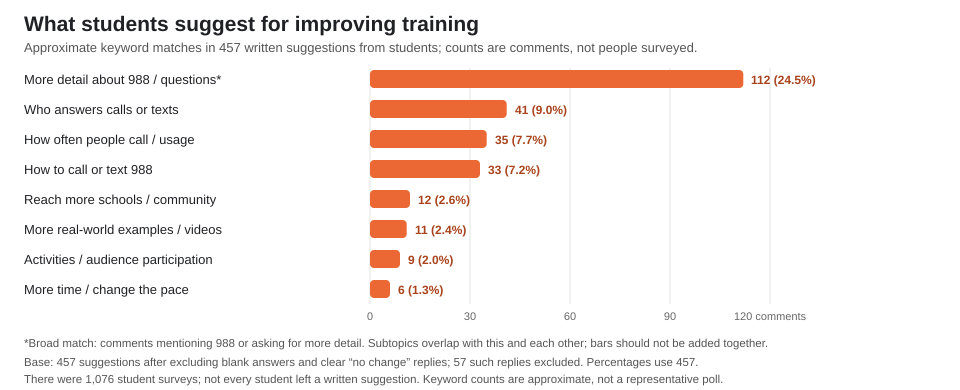

# Memo: Improving Student Engagement and Recommendations for 988 Training

**To:** EveryMind training team  
**From:** Survey analysis  
**Date:** November 7, 2026  
**Subject:** Student and adult survey findings and practical training improvements

## Key findings

*Figure 1. Student and adult survey results; item response counts are shown below the chart.*

Both groups reported similarly high knowledge after training. The most notable differences are students’ lower ratings of the training experience and willingness to recommend it. This points to improving student engagement and opportunities to apply the material—not assuming students need a different core lesson. The findings are descriptive and do not establish why the gap exists.

## Methodology

We used the provided Excel survey. People who selected Student alone were counted as students; everyone else was counted as an adult. For the knowledge and presenter questions, we counted Agree and Strongly agree together. For recommendation and likelihood of calling 988, we counted ratings of 9 or 10. We used only answers submitted for each question, so the number of people behind each percentage varies. The written student suggestions were reviewed with simple keyword searches; a comment could match more than one topic, and these counts are approximate. “Before training” answers were recalled after the course, not collected in a separate pre-training test.

## Recommendations

*Figure 2. Student suggestion themes. Keyword themes can overlap; see chart for response base and limits.*

1. **Answer students’ most common questions about 988.** Comments most often mentioned 988 or asked for more information; recurring specifics included who answers calls or texts, how often people call, and how to contact 988. Create a plain-language FAQ and take-home resource that addresses these questions, and have EveryMind’s 988 program staff check the information for accuracy. Job aids and practical resources can help learners use training after the session (eLearning Industry, n.d.).
2. **Teach the answers through brief examples and practice.** Use a few short, visual, and fictional scenarios about when someone might call or text 988 and what they might want to know. Pause for a quick poll or question after each one. The articles recommend real-world examples, activities, quizzes, and short focused sections as ways to move learners beyond passive listening (Harkey, 2023; eLearning Industry, n.d.).
3. **Make room for student questions and test the change.** Invite anonymous questions or a short discussion, without asking students to share personal experiences. Try the FAQ and practice activities in upcoming student sessions, then compare student engagement and recommendation ratings with the current format. Keep survey questions consistent across student and adult forms so future comparisons are fair.

## Implementation

1. **Prepare the pilot:** The training lead and a 988 program subject-matter expert should draft the plain-language FAQ, take-home resource, and short practice scenarios. The subject-matter expert should verify all 988 information before use.
2. **Update the student session and survey:** Trainers should add the FAQ, scenarios, and a brief question or poll to the next student sessions. The program coordinator should use the same core survey questions for students and adults and keep the recommendation and call-likelihood questions on each form.
3. **Run the analysis each quarter:** After each quarterly training batch, the program coordinator exports the survey results as Excel or CSV and opens them in the local browser-based tool on a work computer. The coordinator reviews data warnings, asks the survey owner to clarify unfamiliar answer labels before interpreting them, and selects the student/adult comparison.
4. **Review and decide:** The coordinator shares aggregate results—not identifiable responses—with the training lead. Compare student presenter-engagement and recommendation ratings, knowledge ratings, and comment themes with the current results. After several consistent quarterly batches, decide with trainers whether to keep, revise, or remove the pilot changes.

The coordinator needs access to the survey export, the local analysis tool, and time from the training lead and 988 subject-matter expert to review results and confirm content. The survey tool processes data locally; keep the original export protected and share only aggregate findings.

## Limitations

Findings reflect the responses and survey versions in this file, not necessarily every participant or future class. Student responses substantially outnumber adult responses; the adult call-likelihood result is based on only 40 people, and that question was blank or absent for 1,006 responses (77%). Some answer labels (“Very agree” and “Satisfied”) do not match the survey’s usual choices, so their meaning should be confirmed before including them. Ratings are self-reported, recalled “before” answers may be affected by memory, and keyword searches can miss suggestions or count a comment under multiple topics. This analysis cannot show that a training change will cause recommendations to rise.

## References

eLearning Industry. (n.d.). *Ways to make online training more engaging and actionable*. Retrieved November 7, 2026, from https://elearningindustry.com/ways-to-make-online-training-more-engaging-and-actionable

GitHub. (2026). Submit a 1–2 page memo explaining your approach, findings, and recommendations for improving recommendations and engagement among students for a nontechnical audience. *GitHub Copilot* [AI assistant]. https://github.com/features/copilot

Harkey, L. (2023, June 7). *Top 5 techniques for increasing learner engagement in online training*. Online Training Concepts. https://onlinetrainingconcepts.com/learner-engagement-and-retention/top-5-techniques-for-increasing-learner-engagement-in-online-training/

